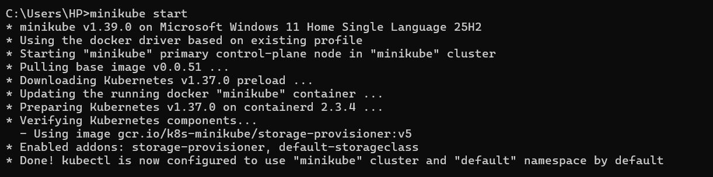
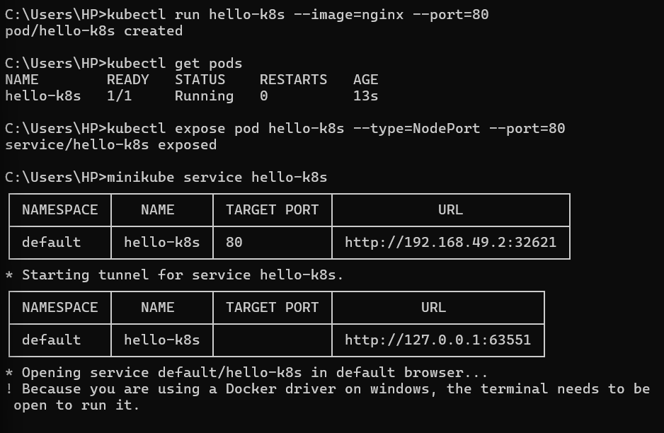
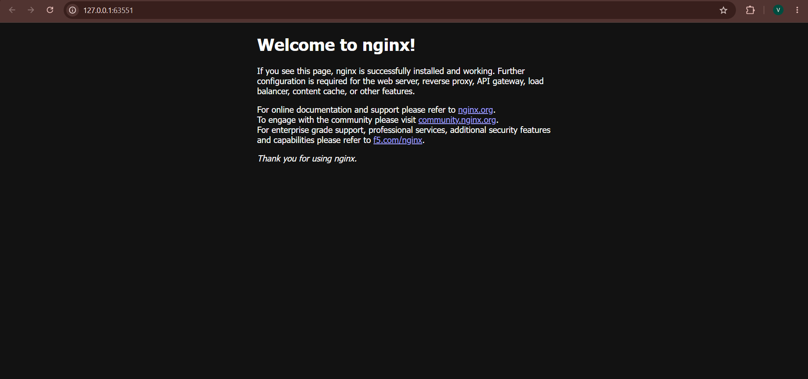

# Exercise 01: Hello Pod --- Deploy NGINX on Kubernetes

## Objective

Deploy an NGINX container on a local Kubernetes cluster using Minikube,
expose it through a Kubernetes Service, and access the NGINX welcome
page in a browser.

## Scenario

Simulate deploying a lightweight storefront and delivery-status web page
for a business such as Zepto. NGINX is used as the sample web
application.

## Prerequisites

-   Windows 11
-   Docker Desktop
-   Minikube
-   `kubectl`

## Tools and Technologies

-   Kubernetes
-   Minikube
-   Docker
-   NGINX
-   kubectl

## Steps

### 1. Start Minikube

``` bash
minikube start
```

Minikube starts a local Kubernetes cluster. In this run, it used the
Docker driver and Kubernetes v1.37.0.



### 2. Create an NGINX Pod

``` bash
kubectl run hello-k8s --image=nginx --port=80
```

This creates a Pod named `hello-k8s` using the NGINX container image.

### 3. Verify the Pod

``` bash
kubectl get pods
```

Expected status:

``` text
NAME        READY   STATUS    RESTARTS
hello-k8s   1/1     Running   0
```

The output confirmed that the Pod was running and the container was
ready.

### 4. Expose the Pod as a Service

``` bash
kubectl expose pod hello-k8s --type=NodePort --port=80
```

This creates a `NodePort` Service named `hello-k8s` to make the
application accessible.

### 5. Access the application

``` bash
minikube service hello-k8s
```

Minikube provides a URL for the Service and opens it in the default
browser. With the Docker driver on Windows, keep the terminal open while
using the service tunnel.



## Result

The browser displayed the default **Welcome to nginx!** page. This
confirms that the NGINX application was running inside the Kubernetes
Pod and was accessible through the Service.



## Key Learnings

-   Starting a local Kubernetes cluster with Minikube.
-   Creating and inspecting a Pod with `kubectl`.
-   Exposing a Pod using a `NodePort` Service.
-   Accessing a Kubernetes application through `minikube service`.
-   Understanding the basic relationship between Pods and Services.

## Cleanup (Optional)

Delete the Service and Pod when they are no longer needed:

``` bash
kubectl delete service hello-k8s
kubectl delete pod hello-k8s
```

Stop Minikube:

``` bash
minikube stop
```
