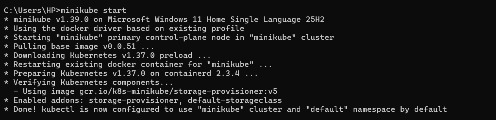
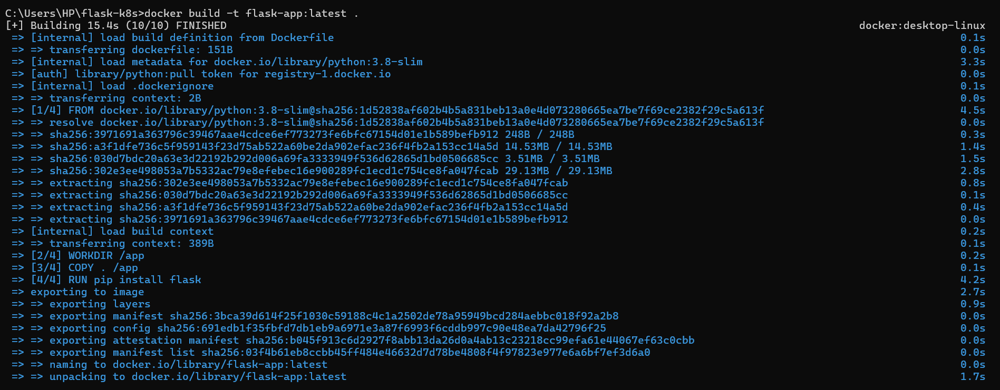
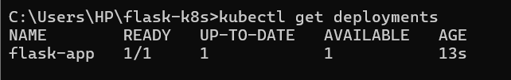
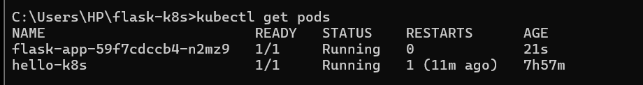
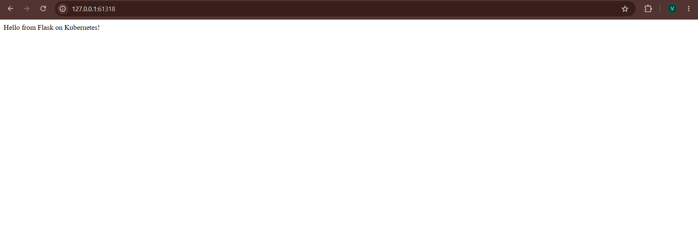
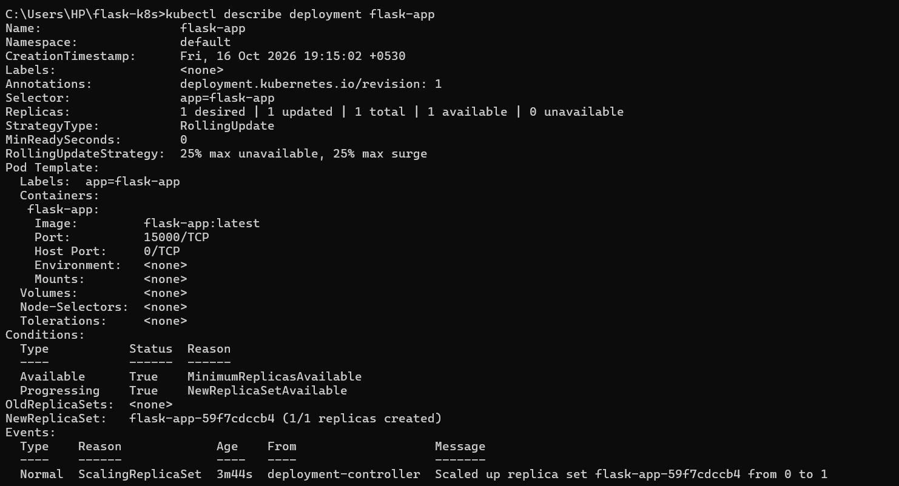
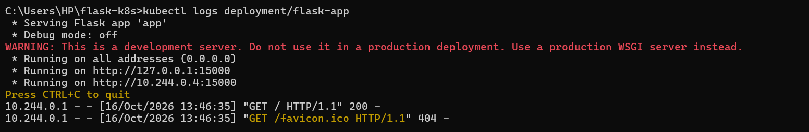
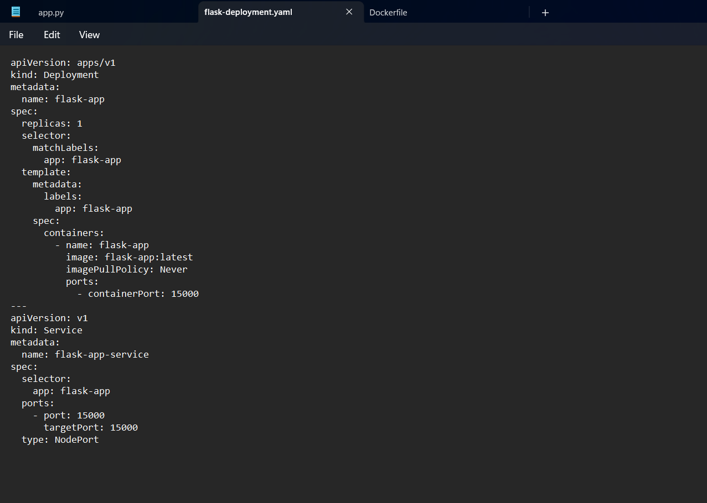
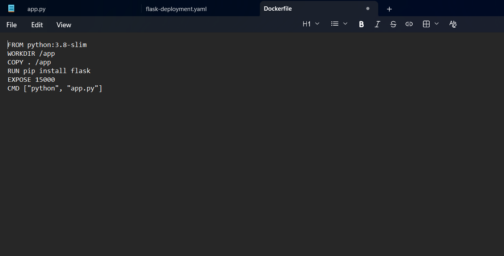

# Exercise 02: Deploy a Flask Application on Kubernetes with Minikube

## Objective

Build a Docker image for a Python Flask application, deploy it to a
local Kubernetes cluster using Minikube and a YAML manifest, expose it
with a Kubernetes Service, and verify that the application responds
successfully.

## Tools and Technologies

-   Kubernetes
-   Minikube
-   Docker
-   Python
-   Flask
-   `kubectl`
-   YAML

## Application

The Flask application returns the following message at the root route:

``` text
Hello from Flask on Kubernetes!
```

It listens on port `15000`.

### `app.py`

``` python
from flask import Flask

app = Flask(__name__)

@app.route('/')
def home():
    return "Hello from Flask on Kubernetes!"

if __name__ == '__main__':
    app.run(host='0.0.0.0', port=15000)
```

## Dockerfile

The Dockerfile uses the `python:3.8-slim` base image, sets `/app` as the
working directory, copies the application files, installs Flask, exposes
port `15000`, and starts the application.

``` dockerfile
FROM python:3.8-slim
WORKDIR /app
COPY . /app
RUN pip install flask
EXPOSE 15000
CMD ["python", "app.py"]
```

## Procedure

### 1. Start Minikube

``` bash
minikube start
```

Minikube started successfully using the Docker driver, with Kubernetes
components running.



### 2. Build the Docker image

From the directory containing `app.py` and `Dockerfile`, build the
image:

``` bash
docker build -t flask-app:latest .
```

The image build completed successfully.



### 3. Deploy the application using Kubernetes YAML

The manifest `flask-deployment.yaml` defines a Deployment named
`flask-app` with one replica. The container uses `flask-app:latest`,
`imagePullPolicy: Never`, and container port `15000`. The manifest also
defines a NodePort Service named `flask-app-service`.

Apply the manifest:

``` bash
kubectl apply -f flask-deployment.yaml
```


### 4. Verify the Deployment

``` bash
kubectl get deployments
```

The `flask-app` Deployment showed `1/1` ready, with one replica up to
date and available.



### 5. Verify the Pods

``` bash
kubectl get pods
```

The Flask Pod showed `1/1` ready and `Running`.



### 6. Access the application

The application was opened in a browser through the Minikube Service URL
and displayed:

``` text
Hello from Flask on Kubernetes!
```



### 7. Check Minikube and Service status

``` bash
minikube status
kubectl get deployments
kubectl get pods
kubectl get services
```

The Minikube host, kubelet, and API server were running. The
`flask-app-service` Service was configured as `NodePort`.


### 8. Inspect the Deployment

``` bash
kubectl describe deployment flask-app
```

The details showed one desired replica, one available replica, and the
`flask-app:latest` image configured on container port `15000`.



### 9. Check application logs

``` bash
kubectl logs deployment/flask-app
```

The logs showed Flask serving the application on port `15000`. Flask
also displayed a warning that its built-in development server is not
intended for production use.



## Configuration Files

### `flask-deployment.yaml`

The manifest contains a Deployment and a Service:

-   Deployment: `flask-app`
-   Replicas: `1`
-   Container image: `flask-app:latest`
-   Image pull policy: `Never`
-   Container port: `15000`
-   Service: `flask-app-service`
-   Service type: `NodePort`
-   Service port and target port: `15000`

The `Never` image pull policy instructs Kubernetes to use the locally
available image rather than attempting to pull it from a registry.



### `Dockerfile`



## Understanding the Service

The Service maps its `port` to the container's `targetPort`. In this
exercise, both are set to `15000`, allowing requests received by the
Service to be forwarded to the Flask application listening on that port.

To obtain the URL for the Service:

``` bash
minikube service flask-app-service --url
```

Use the URL printed by Minikube to access the application. Keep the
terminal open if Minikube indicates that the Docker driver requires it
to maintain the service tunnel.

## Result

The Flask application was built into a Docker image and deployed to
Kubernetes using Minikube. The Deployment had one available replica, the
Pod was running, and the application returned
`Hello from Flask on Kubernetes!` through the exposed Service.

## Key Learnings

-   Building a Docker image for a Python Flask application.
-   Deploying a container image with a Kubernetes Deployment.
-   Defining Kubernetes resources in a YAML manifest.
-   Exposing an application through a NodePort Service.
-   Checking Deployment, Pod, Service, and application log status with
    `kubectl`.
-   Accessing a local Kubernetes Service using Minikube.
