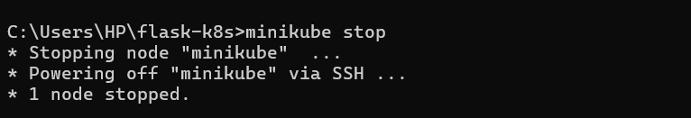
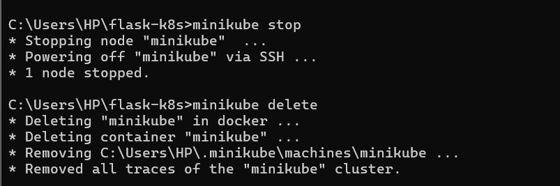
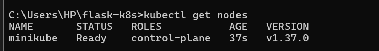
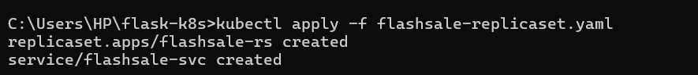
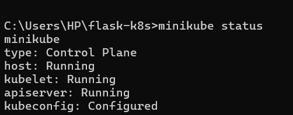
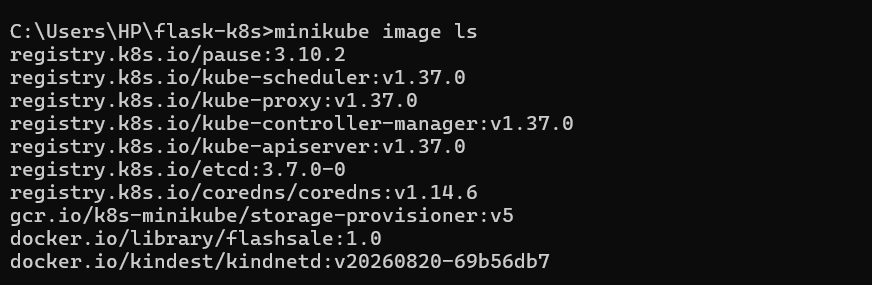
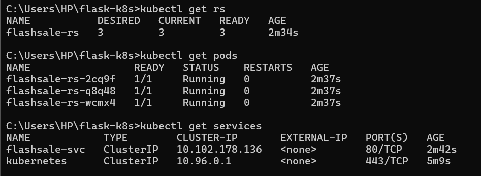
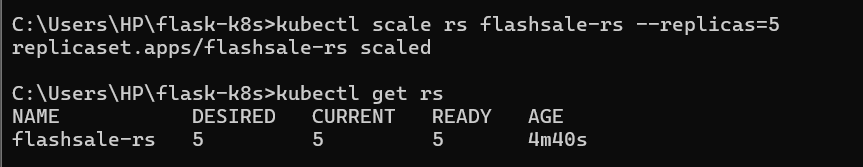
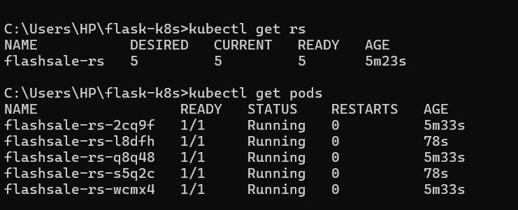

# Exercise 03: Scaling a Flask App with Kubernetes ReplicaSets

## Objective

Learn how Kubernetes ReplicaSets maintain a desired number of Pods,
scale a Flask application from three to five replicas, and replace a Pod
that is deleted manually.

## Real-Life Use Case: E-commerce Flash Sale

During a flash sale, an e-commerce application may experience a sudden
increase in traffic. Running multiple copies of an application helps
provide additional capacity. A ReplicaSet maintains the configured
number of Pod replicas and creates a replacement when a managed Pod is
deleted.

## Tools and Technologies

-   Kubernetes
-   Minikube
-   Docker
-   Flask
-   `kubectl`
-   YAML
-   ReplicaSet and ClusterIP Service

## Application Overview

The exercise describes a Flask flash-sale service with these endpoints:

-   `/` --- returns a welcome message and the hostname of the Pod
    serving the request.
-   `/buy` --- simulates a checkout response with a randomly selected
    item and user.
-   `/health` --- returns a health status and Pod hostname for
    Kubernetes health probes.

The ReplicaSet manifest configures the application to listen on
container port `5000`.

## Procedure

### 1. Stop and delete the previous Minikube cluster

``` bash
minikube stop
minikube delete
```

The previous Minikube node was stopped and the cluster was deleted.





### 2. Start a single-node Minikube cluster

``` bash
minikube start --nodes=1
```

Minikube started successfully using the Docker Desktop driver and
configured Kubernetes.


Verify the node:

``` bash
kubectl get nodes
```

The `minikube` node was in the `Ready` state.



### 3. Configure the ReplicaSet and Service

The file `flashsale-replicaset.yaml` defines a ReplicaSet named
`flashsale-rs` with three desired replicas. The Pod template uses the
`flashsale:1.0` image and exposes container port `5000`.

The manifest also configures: - A readiness probe using `/health` on
port `5000`. - A liveness probe using `/health` on port `5000`. - CPU
and memory requests and limits. - A ClusterIP Service named
`flashsale-svc` that exposes port `80` and forwards traffic to target
port `5000`.


### 4. Apply the Kubernetes manifest

``` bash
kubectl apply -f flashsale-replicaset.yaml
```

The ReplicaSet and Service were created successfully.



### 5. Verify the Minikube cluster

``` bash
minikube status
```

The Minikube host, kubelet, and API server were running, and the
kubeconfig was configured.



### 6. Verify the local image

``` bash
minikube image ls
```

The image list included `docker.io/library/flashsale:1.0`.



### 7. Verify the initial three replicas

``` bash
kubectl get rs
kubectl get pods
kubectl get services
```

The ReplicaSet reported three desired, current, and ready replicas.
Three Pods were running, and the `flashsale-svc` Service was configured
as `ClusterIP`.



### 8. Scale the ReplicaSet to five replicas

``` bash
kubectl scale rs flashsale-rs --replicas=5
kubectl get rs
```

The ReplicaSet was scaled from three to five replicas. Kubernetes
created two additional Pods to meet the new desired count.



### 9. Verify all five Pods

``` bash
kubectl get rs
kubectl get pods
```

The ReplicaSet reported five desired, current, and ready replicas, and
five Pods were running.



### 10. Delete one Pod and observe self-healing

Deleting a Pod managed by a ReplicaSet demonstrates its reconciliation
behavior: Kubernetes creates a replacement Pod to return to the desired
replica count.

Example command:

``` bash
kubectl delete pod <pod-name>
kubectl get pods
```

In the recorded result, a Pod was deleted and a new Pod appeared. Five
Pods remained running.


## Key Learnings

-   A ReplicaSet maintains the desired number of Pod replicas.
-   Scaling a ReplicaSet from three to five replicas adds two Pods.
-   A deleted Pod managed by a ReplicaSet is replaced automatically.
-   Readiness and liveness probes can check an application's `/health`
    endpoint.
-   `kubectl get pods -o wide` can show the node on which each Pod is
    running.
-   A ClusterIP Service provides an internal endpoint for selected Pods.

## Result

A single-node Minikube cluster was started, the `flashsale-rs`
ReplicaSet and `flashsale-svc` Service were created, the ReplicaSet was
scaled from three to five replicas, and a deleted Pod was replaced to
maintain the desired count.

## Additional Challenges

-   Update the ReplicaSet manifest to use a different image.
-   Create a Deployment instead of a standalone ReplicaSet.
-   Use `kubectl describe` to inspect the ReplicaSet and Pods.
-   Use `kubectl logs` and `kubectl exec` to inspect application
    behavior.
-   Run `kubectl get pods -o wide` to observe Pod placement across
    nodes.
