# Exercise 04: Docker Networking with Multiple Containers

## Objective
Understand Docker networking and configure a multi-container application using a custom bridge network.

## Scenario
The exercise uses a Flask web server (`flask`), a MySQL container (`mysql`), and a Redis container (`redis`). The goal is to create and inspect a user-defined bridge network, verify container-name resolution, and clean up resources.

## Tools and Technologies
- Docker Desktop and Docker CLI
- Python and Flask
- MySQL and Redis container images
- User-defined bridge network

## Steps Performed

### 1. Create a bridge network
```cmd
docker network create --driver bridge my-bridge-net
```
Docker created `my-bridge-net`.

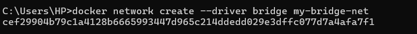

### 2. List Docker networks
```cmd
docker network ls
```
The output included `my-bridge-net` with the `bridge` driver and `local` scope.

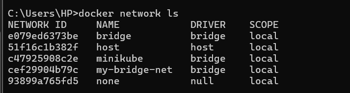

### 3. Inspect the network
```cmd
docker network inspect my-bridge-net
```
The output showed IPv4 enabled, subnet `172.18.0.0/16`, and gateway `172.18.0.1`. No containers were attached at the time of inspection.

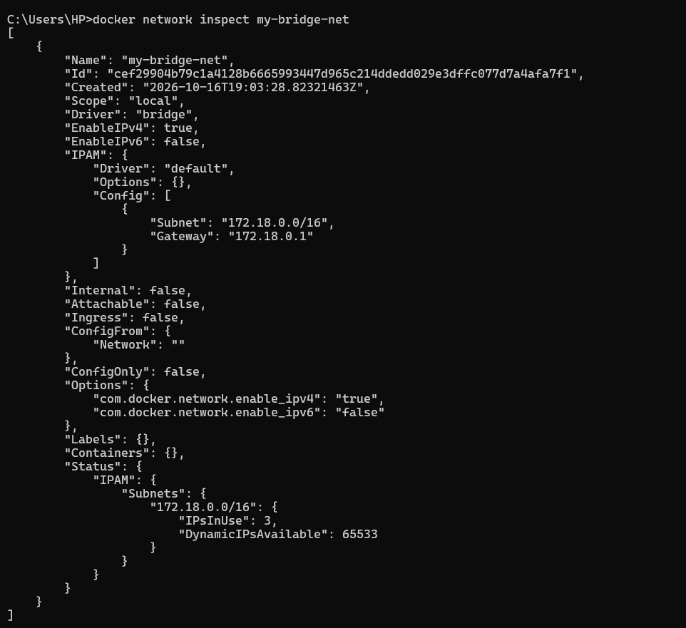

### 4. Create the Flask REST API
The Flask app exposes `GET /about`, returning JSON describing the API.

```python
from flask import Flask, jsonify

app = Flask(__name__)

@app.route('/about', methods=['GET'])
def about():
    return jsonify({
        "name": "Simple REST API",
        "version": "1.0",
        "description": "This is a simple REST API built with Flask."
    })

if __name__ == '__main__':
    app.run(host='0.0.0.0', debug=True, port=5001)
```

The app listens on port `5001` and binds to `0.0.0.0` so it can be reached from outside the container.

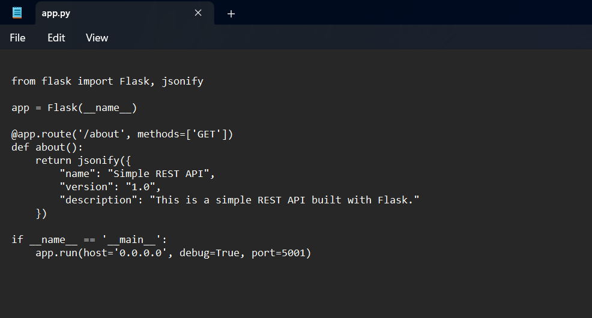

### 5. Define dependencies
`requirements.txt` contains:

```text
Flask==2.0.1
Werkzeug==2.0.3
```

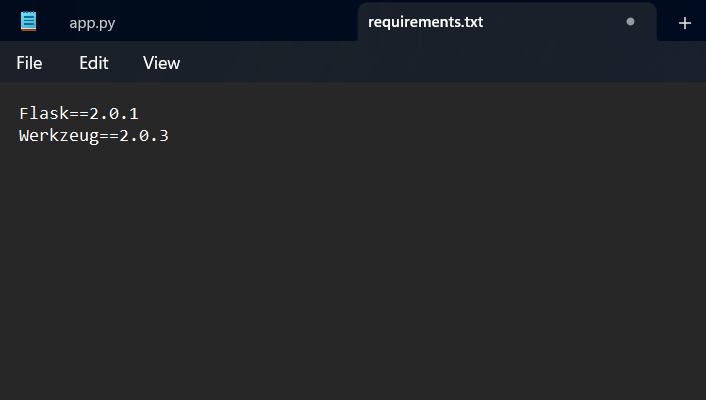

### 6. Create the Dockerfile
```dockerfile
FROM python:3.9-slim

WORKDIR /app
COPY requirements.txt .
COPY app.py .
RUN pip install --no-cache-dir -r requirements.txt
EXPOSE 5001
CMD ["python", "app.py"]
```

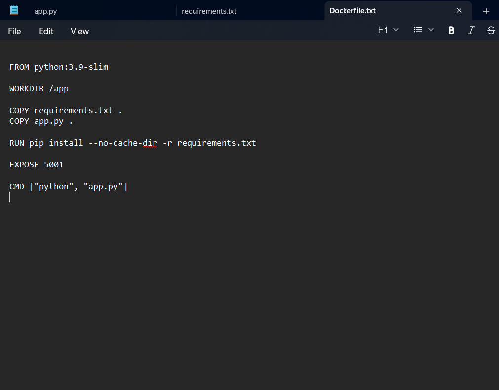

### 7. Build the Flask image
```cmd
docker build -t flask-api .
```
The build completed successfully and created `flask-api:latest`.

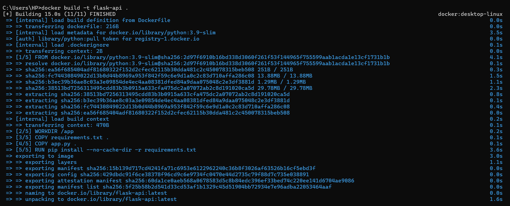

### 8. Verify local images
```cmd
docker images
```
The list included `flask-api:latest` and `flask-app:latest`.

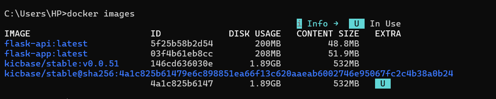

### 9. Review Docker networks
```cmd
docker network ls
```
The output showed `my-bridge-net` alongside Docker's default networks and the Minikube network.

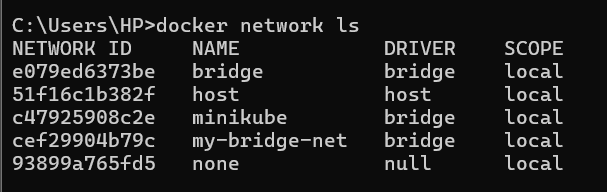

### 10. Verify container-name resolution
Inside the Flask container, these commands were run:

```cmd
docker exec -it flask bash
python -c "import socket; print(socket.gethostbyname('mysql'))"
python -c "import socket; print(socket.gethostbyname('redis'))"
```

The output resolved `mysql` to `172.18.0.2` and `redis` to `172.18.0.3`. This demonstrates name resolution; it does not by itself prove a database login or Redis command succeeded.

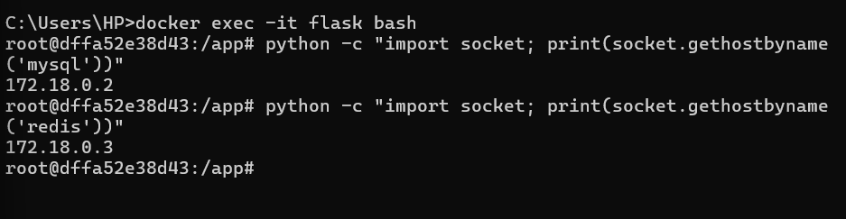

### 11. Stop and remove containers
```cmd
docker stop mysql redis flask && docker rm mysql redis flask
```
The three containers were stopped and removed.

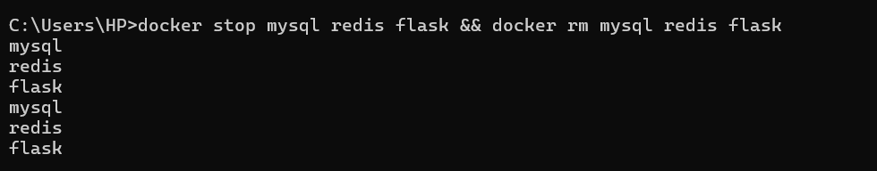

### 12. Remove the custom network
```cmd
docker network rm my-bridge-net
```
Docker confirmed that `my-bridge-net` was removed.

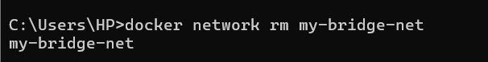

## Questions and Answers

### 1. What is the purpose of `--net` in `docker run`?
It specifies the network to which a container should connect. For example, `--net=my-bridge-net` connects a container to the custom bridge network.

### 2. How can containers communicate on the same user-defined bridge network?
They can use container names or IP addresses, provided the relevant service is listening and its ports are accessible.

### 3. What is the difference between bridge and host networking?
- **Bridge:** Containers connect through an isolated Docker-managed network.
- **Host:** A container shares the host's network namespace; behavior and support depend on the operating system and Docker environment.

### 4. How can a container port be exposed to the host?
Use `-p`, for example `-p 5001:5001`, to map host port `5001` to container port `5001`.

## Key Learnings
- Create and inspect a custom Docker bridge network.
- Build a Docker image for a Flask REST API.
- Use network membership for container-name resolution.
- Publish container ports with `-p`.
- Clean up containers and networks after the exercise.

## Result
The custom `my-bridge-net` bridge network was created and inspected. The Flask API image built successfully, container-name resolution for `mysql` and `redis` was demonstrated from the Flask container, and the containers and custom network were removed during cleanup.
