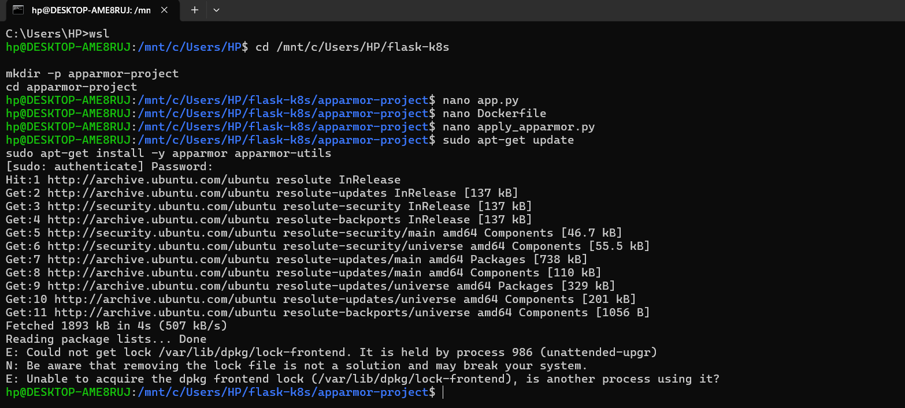
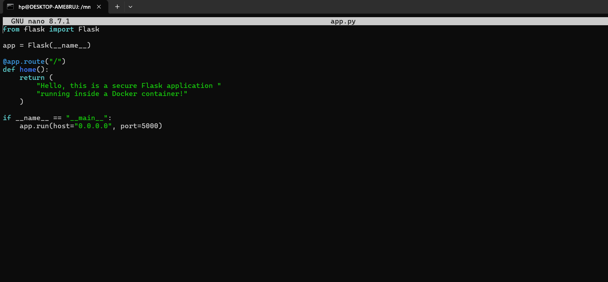
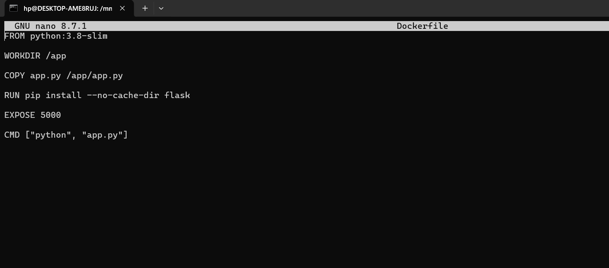
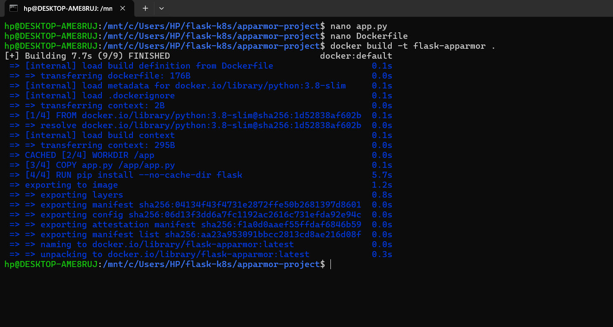
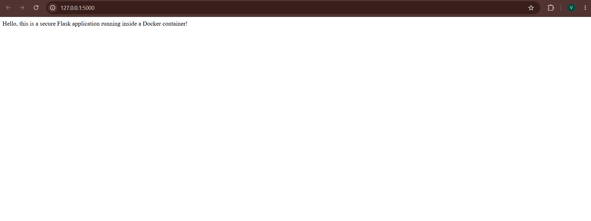
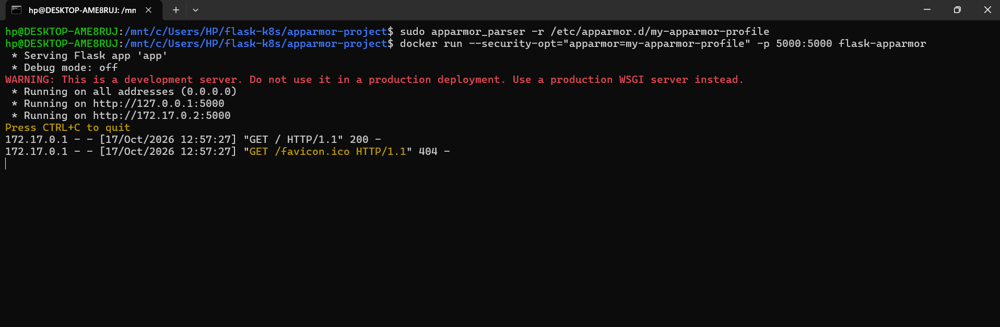
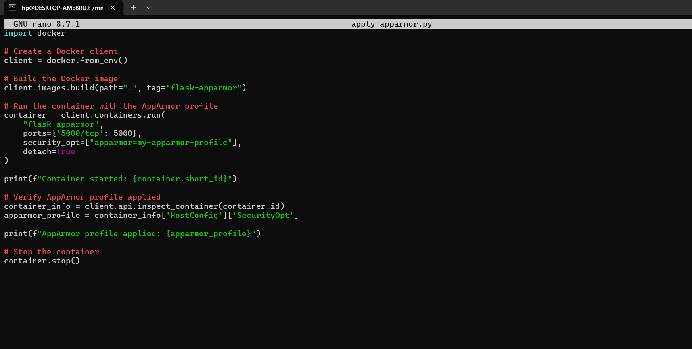
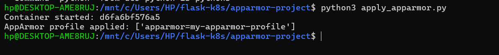
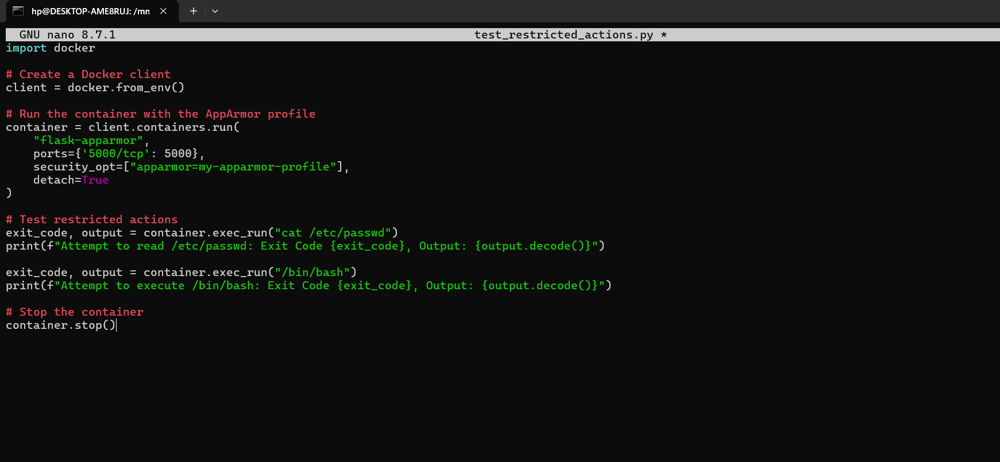
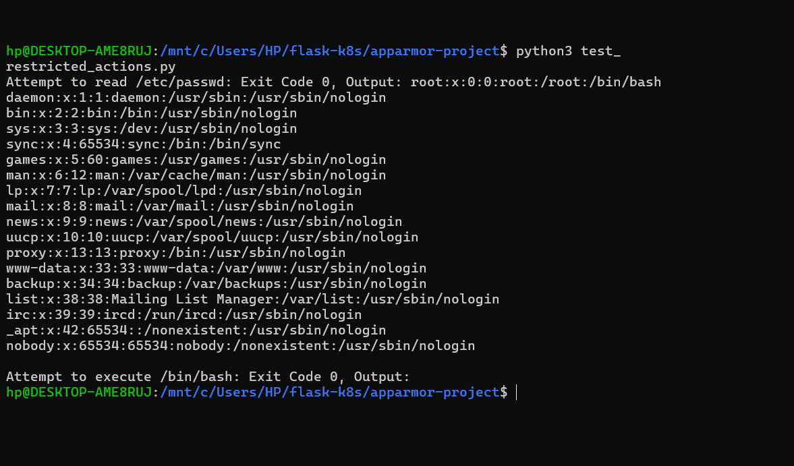

# Exercise 05: Docker Security with AppArmor and Python

## Objective
Understand AppArmor profiles for Docker containers, apply a profile when launching a container, inspect the configured security option with the Docker SDK for Python, and test restricted actions.

## Tools and Technologies
- Docker Desktop with WSL 2 / Ubuntu
- Docker CLI
- Python and Flask
- AppArmor and `apparmor_parser`
- Docker SDK for Python

## Files
- `app.py` — Flask application
- `Dockerfile` — image build instructions
- `apply_apparmor.py` — builds the image, runs a container with an AppArmor option, inspects its security options, and stops it
- `test_restricted_actions.py` — tests reading `/etc/passwd` and executing `/bin/bash`
- `screenshots/` — screenshots of steps and outputs

## Steps Performed

### 1. Install AppArmor utilities
Attempted:

```bash
sudo apt-get update
sudo apt-get install -y apparmor apparmor-utils
```

The first attempt reported that the `dpkg` frontend lock was held by `unattended-upgr` (process 986). Do not manually delete the lock; wait for the background package process to finish and retry if needed.



### 2. Create the Flask application
The app exposes `/` and returns a message.

```python
from flask import Flask

app = Flask(__name__)

@app.route("/")
def home():
    return (
        "Hello, this is a secure Flask application "
        "running inside a Docker container!"
    )

if __name__ == "__main__":
    app.run(host="0.0.0.0", port=5000)
```



### 3. Create the Dockerfile
The image uses Python 3.8 slim, copies the app, installs Flask, exposes port 5000, and starts the application.

```dockerfile
FROM python:3.8-slim
WORKDIR /app
COPY app.py /app/app.py
RUN pip install --no-cache-dir flask
EXPOSE 5000
CMD ["python", "app.py"]
```



### 4. Build the image
```bash
docker build -t flask-apparmor .
```

The build completed successfully.



### 5. Verify the Flask application
The browser opened `http://127.0.0.1:5000` and displayed the expected message.



### 6. Load the AppArmor profile and run the container
```bash
sudo apparmor_parser -r /etc/apparmor.d/my-apparmor-profile
docker run --security-opt="apparmor=my-apparmor-profile" -p 5000:5000 flask-apparmor
```

The terminal showed Flask listening on port 5000 and a successful `GET /` request (HTTP 200).



### 7. Apply the profile using the Docker SDK
`apply_apparmor.py` uses `docker.from_env()`, builds the image, runs a container with `security_opt=["apparmor=my-apparmor-profile"]`, inspects `HostConfig.SecurityOpt`, prints the configured option, and stops the container.

```bash
python3 -m pip install docker
python3 apply_apparmor.py
```

Observed output included:

```text
AppArmor profile applied: ['apparmor=my-apparmor-profile']
```

This confirms the configured security option recorded by Docker; it does not alone prove every intended restriction is enforced.





### 8. Test restricted actions
The test script attempts:

```python
exit_code, output = container.exec_run("cat /etc/passwd")
print(f"Attempt to read /etc/passwd: Exit Code {exit_code}, Output: {output.decode()}")

exit_code, output = container.exec_run("/bin/bash")
print(f"Attempt to execute /bin/bash: Exit Code {exit_code}, Output: {output.decode()}")
```

Run:

```bash
python3 test_restricted_actions.py
```

**Observed result:** Both attempts returned exit code `0`; `/etc/passwd` was readable, and `/bin/bash` executed with no output. The expected denial described in the lab instructions was therefore **not achieved** in this run. The script ran, but these results do not demonstrate enforcement of the two restrictions.





## Questions and Answers

### 1. What is the purpose of AppArmor with Docker?
AppArmor can enforce policies that confine a process to defined file, capability, and network permissions, adding an access-control layer to a container.

### 2. How do AppArmor profiles help secure a container?
A profile specifies allowed and denied operations. Docker can request a profile at container launch, and the host's AppArmor system enforces it when loaded and applicable.

### 3. Why restrict `/etc/` and `/var/`?
They can contain system configuration, account information, logs, and service data. Limiting access can reduce the impact of a compromised process.

### 4. What other capabilities can be restricted?
Depending on profile rules, AppArmor can restrict file reads and writes, execution, network operations, and selected Linux capabilities.

### 5. How can you verify a profile is applied?
Inspect `HostConfig.SecurityOpt` through the Docker SDK or use `docker inspect`. To verify enforcement, also test intended denied operations and check their exit codes and relevant AppArmor audit logs.

## Result
The Flask image built successfully and the app responded on port 5000. The Docker SDK reported `apparmor=my-apparmor-profile` in the configured security options. However, reading `/etc/passwd` and executing `/bin/bash` both returned exit code 0, so those restrictions were not demonstrated as enforced in this run.
