# Exercise 06 — Real-Time Operations Monitoring and Alerting

## Objective
Build a delivery-service monitoring workflow for ZAPPTTO using Python, Prometheus, Grafana, Docker, and Jenkins. The Python application simulates delivery statuses and exposes metrics; Prometheus scrapes them and evaluates alert rules; Grafana visualizes the metrics; Jenkins automates a Docker image build.

## Project structure

```text
Exercise-06/
├── delivery_metrics.py
├── requirements.txt
├── Dockerfile
├── Dockerfile.jenkins
├── prometheus.yml
├── alert_rules.yml
├── Jenkinsfile
└── screenshots/
```

## Components

- **Python / prometheus-client:** publishes `total_deliveries`, `pending_deliveries`, `on_the_way_deliveries`, and the `average_delivery_time` summary on port `8000`.
- **Prometheus:** scrapes the delivery service every 5 seconds and loads `alert_rules.yml`.
- **Grafana:** uses Prometheus as a data source and displays total deliveries, pending deliveries, deliveries on the way, and average delivery time.
- **Docker:** packages the Python application and runs the monitoring services as containers.
- **Jenkins:** runs a pipeline that checks Docker, validates project files, and builds the delivery metrics image. `Dockerfile.jenkins` describes an optional Jenkins image with Docker CLI installed.

## Run the Python metrics application

Create and activate a virtual environment if desired, then install the dependency and start the app:

```bash
python3 -m pip install -r requirements.txt
python3 delivery_metrics.py
```

Open [http://localhost:8000/metrics](http://localhost:8000/metrics) or run:

```bash
curl http://localhost:8000/metrics
```

The program prints changing delivery values once per second. Keep it running while Prometheus scrapes the endpoint.

## Build and run the application container

```bash
docker build -t delivery-metrics .
docker run -d --name delivery-metrics -p 8000:8000 delivery-metrics
```

If a container with that name already exists, remove it before starting another one.

## Run Prometheus

The included `prometheus.yml` uses `host.docker.internal:8000` for the application target, matching the application's port and the demonstrated Prometheus target. On Docker Desktop for Windows/WSL, `host.docker.internal` resolves to the host. If running in another environment, update the target to a reachable address.

```bash
docker run -d --name prometheus -p 9090:9090 \
  -v "$PWD/prometheus.yml:/etc/prometheus/prometheus.yml:ro" \
  -v "$PWD/alert_rules.yml:/etc/prometheus/alert_rules.yml:ro" \
  prom/prometheus
```

Open [http://localhost:9090](http://localhost:9090). Under **Status → Targets**, verify that `delivery_service` is `UP`. Useful queries include:

```promql
total_deliveries
pending_deliveries
on_the_way_deliveries
average_delivery_time_sum / average_delivery_time_count
```

## Run Grafana and configure the dashboard

```bash
docker run -d --name grafana -p 3000:3000 grafana/grafana
```

Open [http://localhost:3000](http://localhost:3000). Add a Prometheus data source using the Prometheus URL reachable from the Grafana container (for example, `http://host.docker.internal:9090` when using Docker Desktop). Create a dashboard with these panels:

1. **Total Deliveries** — `total_deliveries`
2. **Pending Deliveries** — `pending_deliveries`
3. **On-the-Way Deliveries** — `on_the_way_deliveries`
4. **Average Delivery Time** — `average_delivery_time_sum / average_delivery_time_count`

## Alert rules

`alert_rules.yml` defines:

- **HighPendingDeliveries** — warning when `pending_deliveries > 10` for 15 seconds.
- **HighAverageDeliveryTime** — critical when the average delivery time exceeds 30 seconds for 15 seconds.

Because the simulator normally generates 10–20 pending deliveries, the pending-delivery alert can trigger during normal simulation. To demonstrate a sustained threshold breach, temporarily increase the `pending` random range in `delivery_metrics.py`, restart the app, and inspect **Alerts** in Prometheus.

## Jenkins pipeline

The included `Jenkinsfile` is a repository-based pipeline that checks Docker availability, validates required project files, and builds a versioned application image. Jenkins must be able to access the Docker daemon for these stages to work. The optional `Dockerfile.jenkins` installs Docker CLI in a Jenkins image; a Docker socket mount is also required when using the host daemon. Treat Docker socket access as privileged because it grants substantial control over the host.

For the UI-based job shown in the screenshots, open Jenkins at [http://localhost:8080](http://localhost:8080), create or open the pipeline job, and review **Console Output** after a build.

## Verification evidence

The screenshots document the metrics output, `/metrics` endpoint, Prometheus setup and targets, Grafana data source and dashboard, Jenkins container and pipeline, and Prometheus alert states. The captured target status shows Prometheus scraping the delivery service successfully; the captured dashboard shows all four metric panels; the alert view shows pending/firing delivery alerts.

## Screenshots

### Python application continuously simulating delivery metrics.

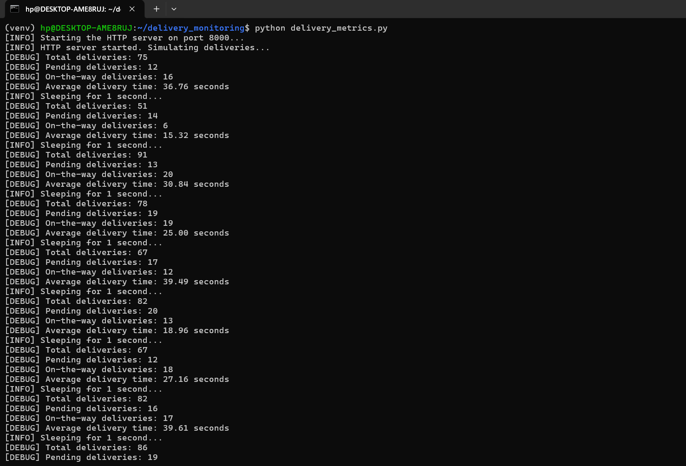

### Prometheus client metrics exposed at /metrics, including custom delivery metrics.

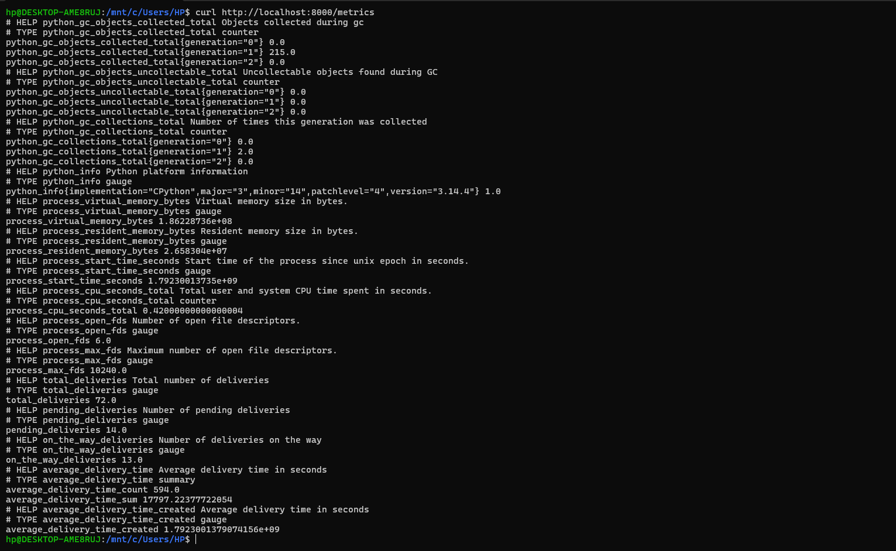

### Prometheus container pulled and started.

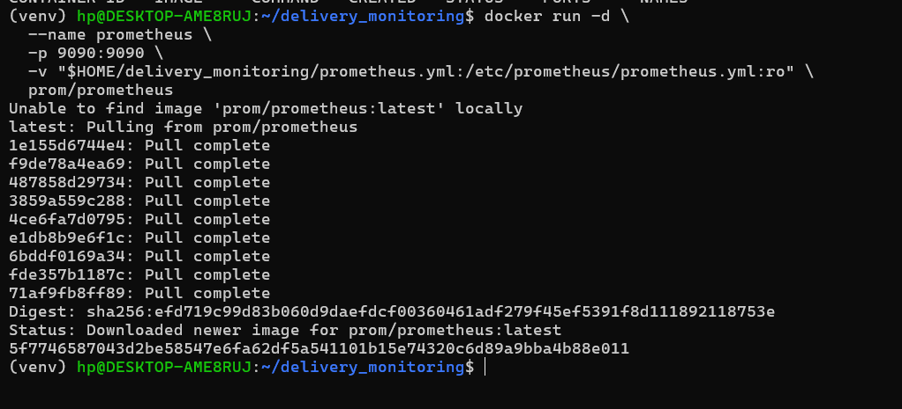

### Prometheus query interface opened.

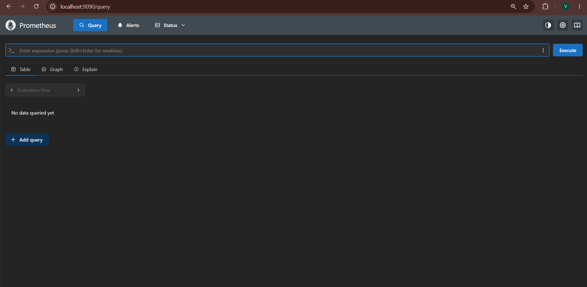

### Grafana login page.

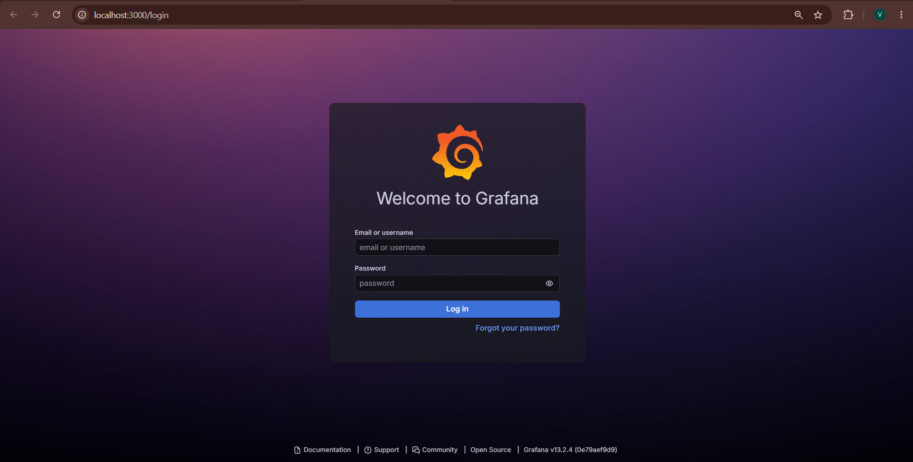

### Prometheus data source configured in Grafana.

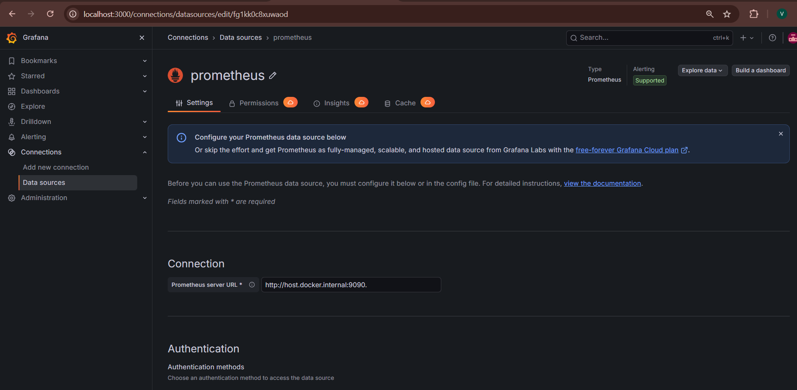

### Grafana panel configured with the total_deliveries query.

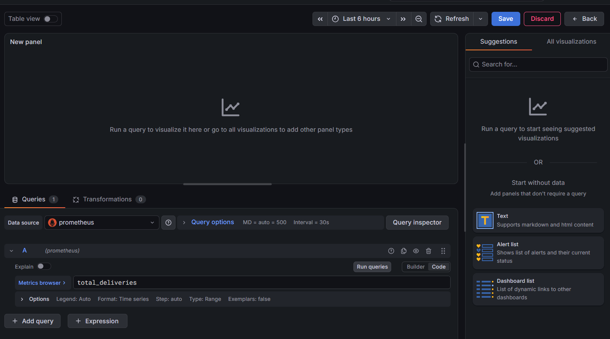

### Prometheus targets page showing delivery_service and Prometheus targets as UP.

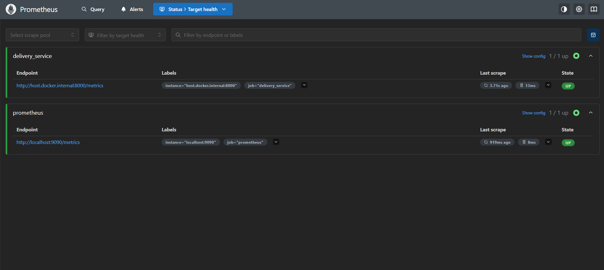

### Delivery Monitoring Dashboard with four panels.

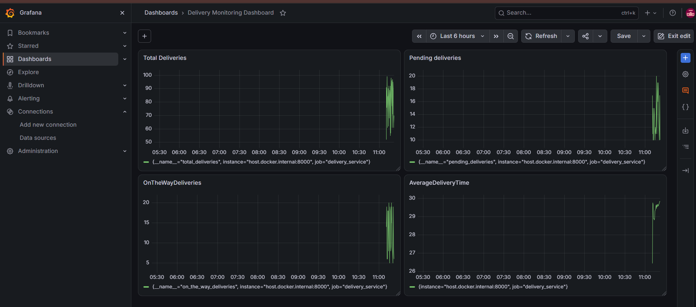

### Jenkins container started with ports 8080 and 50000 mapped.

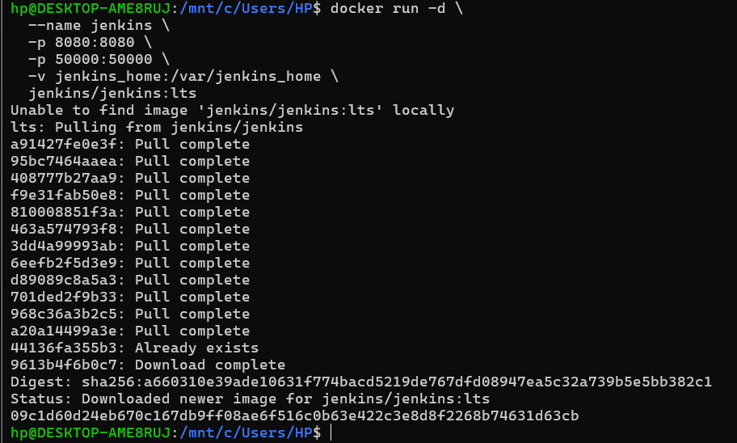

### Docker confirms the Jenkins container is running.

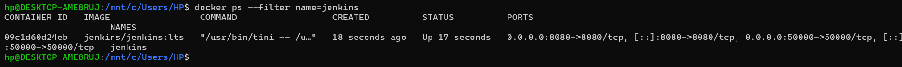

### Jenkins home page.

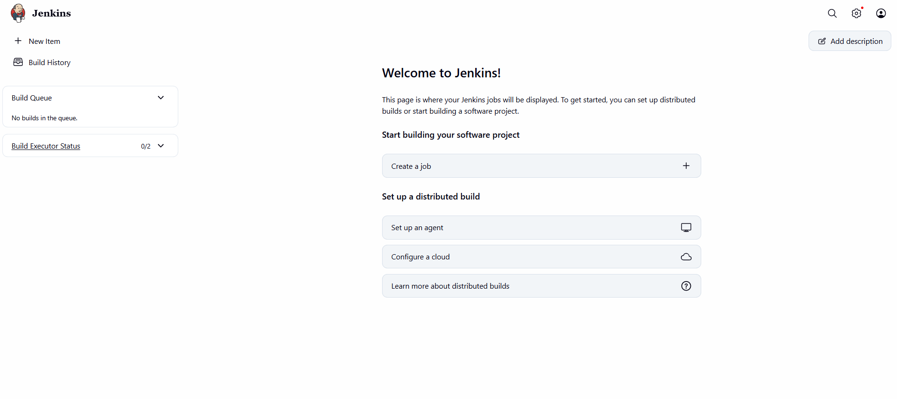

### Dockerfile for a Jenkins image with Docker CLI installed.

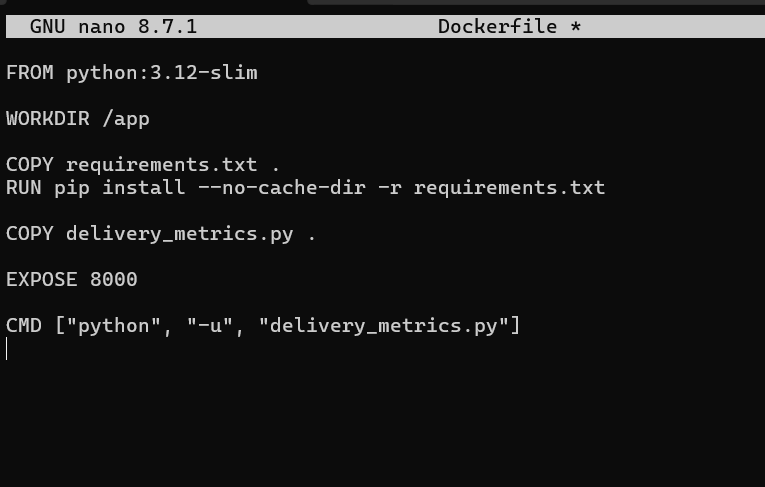

### Prometheus alert rules for pending deliveries and average delivery time.

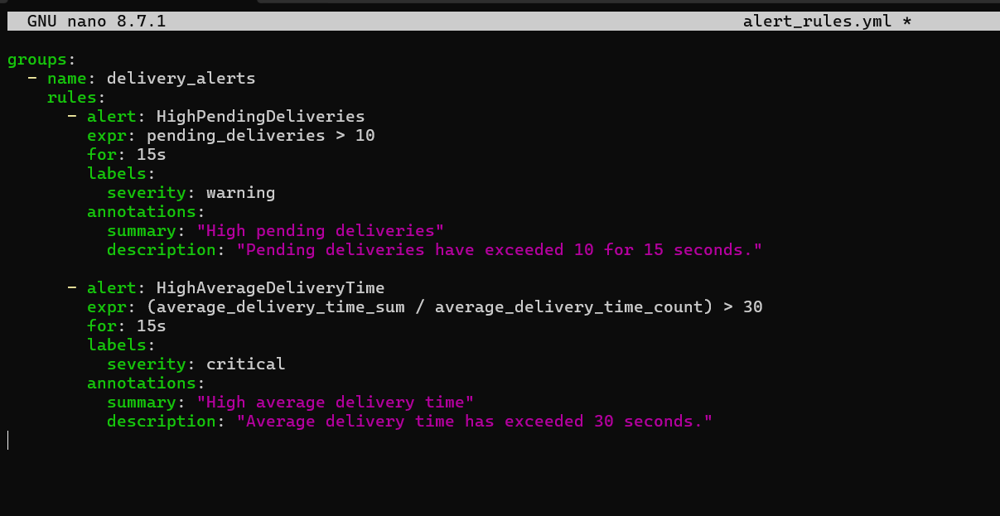

### Jenkins container configured with access to the Docker socket.

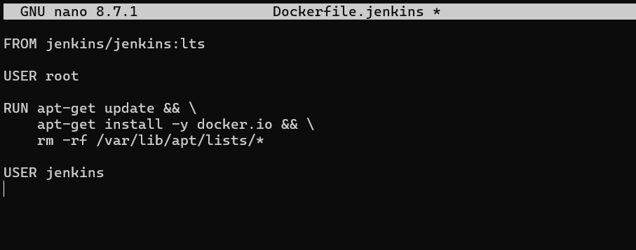

### Docker CLI verified from inside the Jenkins container.

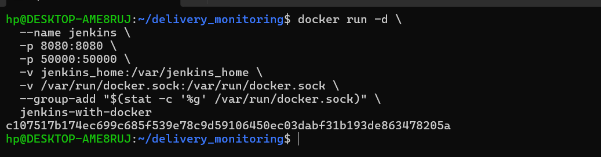

### Prometheus scrape configuration.

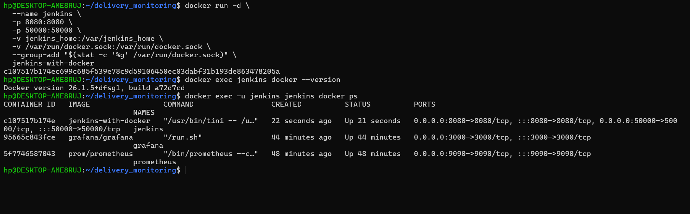

### Jenkins pipeline job listed in the dashboard.

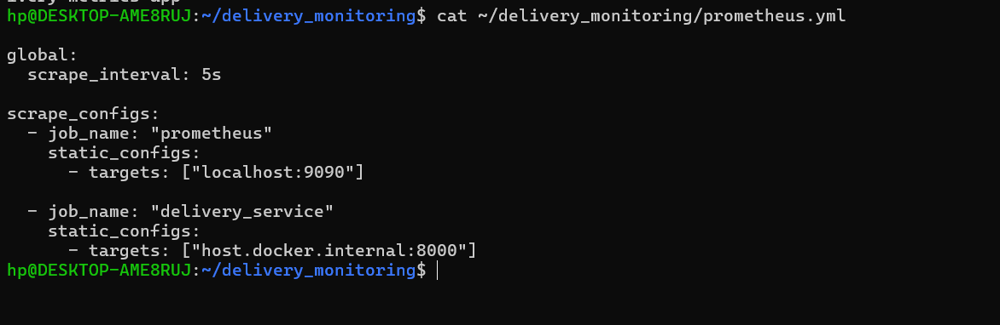

### Jenkins pipeline status showing a successful build.

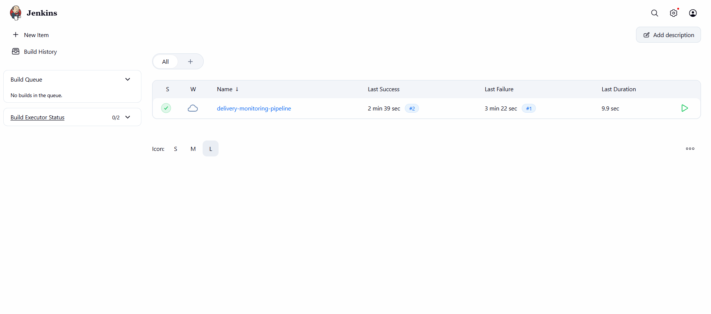

### Prometheus delivery alerts shown as pending/firing.

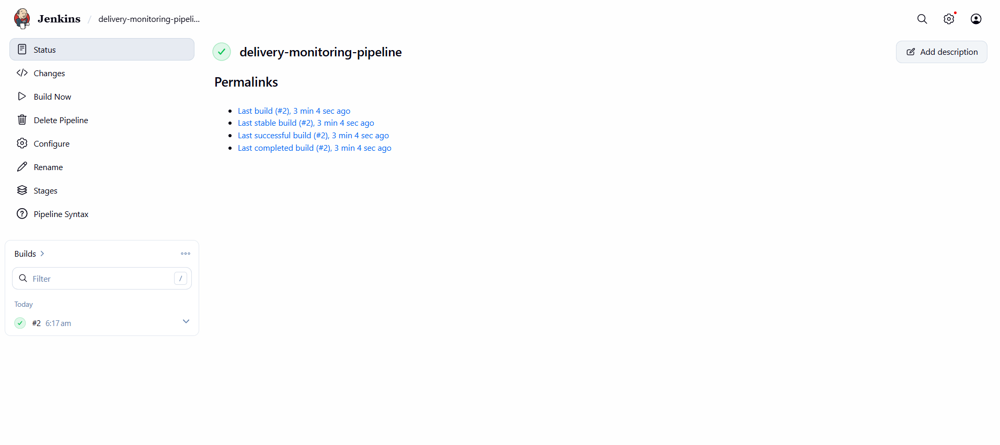

### Final verification screenshot from the monitoring workflow.

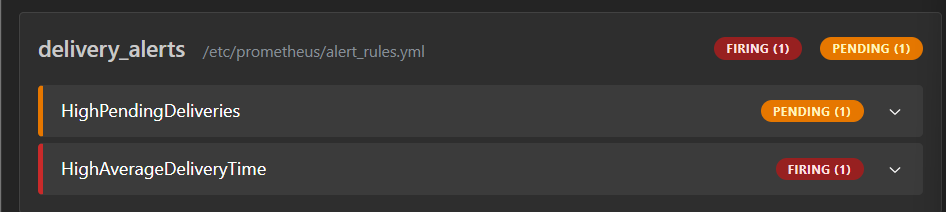

