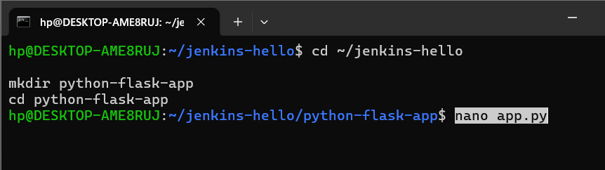
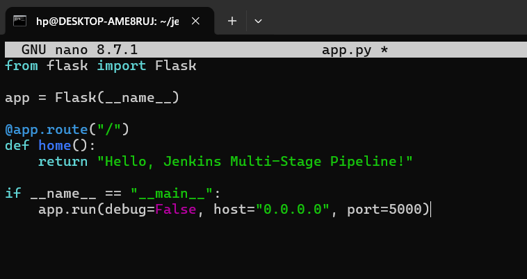
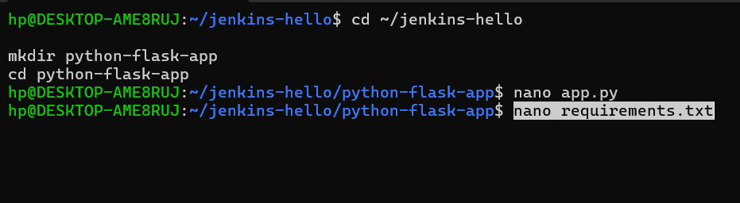
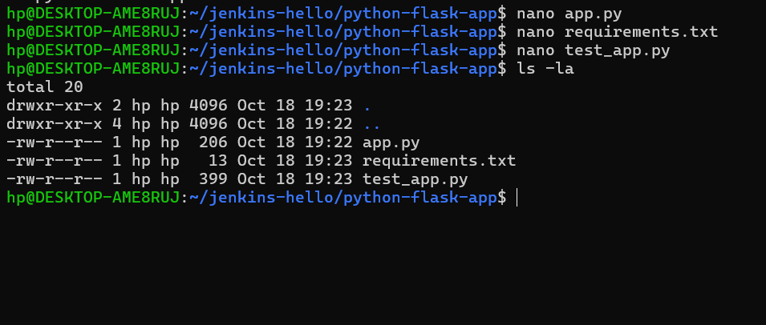
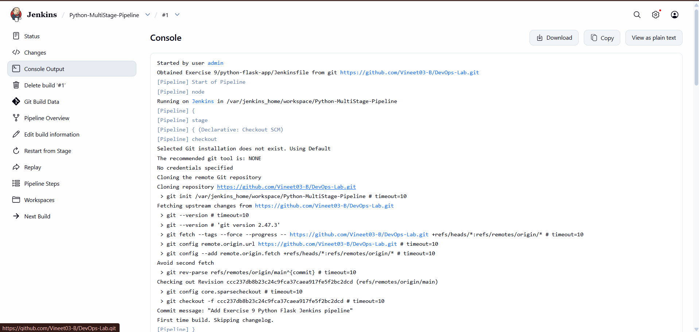
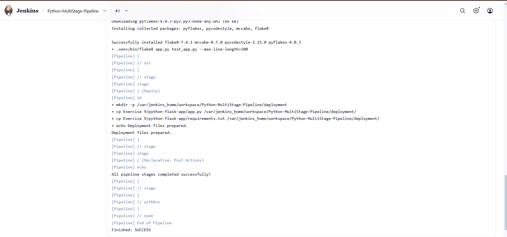
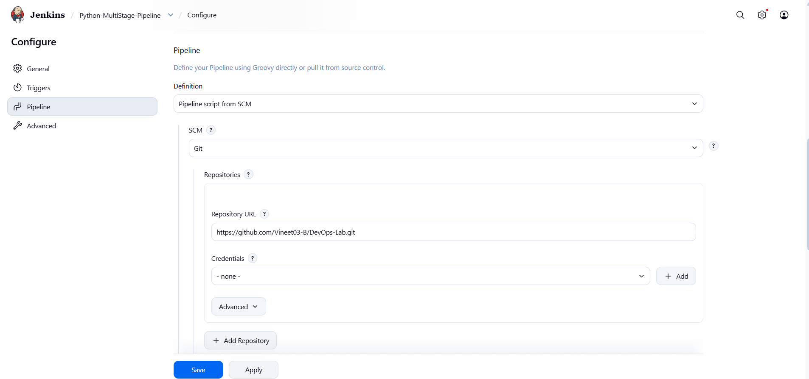

# Jenkins Multi-Stage Pipeline Exercise: Deploying a Python Application

## Objective
Create and run a Jenkins Pipeline for a sample Python Flask application. The pipeline checks out the repository, prepares Python dependencies, runs unit tests, checks code quality with Flake8, and prepares deployment files.

## Repository Structure
```text
DevOps-Lab/
└── Exercise-09/
    ├── README.md
    ├── python-flask-app/
    │   ├── .gitignore
    │   ├── Jenkinsfile
    │   ├── app.py
    │   ├── requirements.txt
    │   └── test_app.py
    └── screenshots/
        ├── 01-create-flask-app.png
        ├── 02-edit-app-py.png
        ├── 03-create-requirements.png
        ├── 04-python-files.png
        ├── 05-jenkins-checkout-console.png
        ├── 06-pipeline-success-console.png
        └── 07-jenkins-pipeline-configuration.png
```

## Scenario
Automate a Flask application workflow using Jenkins with these stages:
1. **Build** — create a virtual environment and install dependencies.
2. **Test** — run the unit tests.
3. **Code Quality** — run Flake8 against the application and test file.
4. **Deploy** — copy the application and requirements file into a deployment directory in the Jenkins workspace.

## Application
The Flask app exposes `/` and returns `Hello, Jenkins Multi-Stage Pipeline!`. The unit test checks for HTTP status `200` and the expected response text.

## Jenkins Pipeline
The `Jenkinsfile` is stored at `Exercise-09/python-flask-app/Jenkinsfile`. It uses a Python virtual environment at `python-flask-app/.venv` and prepares deployment files under `$WORKSPACE/deployment`.

## Jenkins Configuration
- Job: `Python-MultiStage-Pipeline`
- Definition: **Pipeline script from SCM**
- SCM: **Git**
- Repository URL: `https://github.com/Vineet03-B/DevOps-Lab.git`
- Script path: `Exercise-09/python-flask-app/Jenkinsfile`

## Verification
The screenshots document the Flask app files, Jenkins checkout, pipeline configuration, and successful pipeline output. The captured console shows the unit test passing and the pipeline ending with `Finished: SUCCESS`. The Deploy stage prepares files in the Jenkins workspace; it does not configure an external production deployment.

## Screenshots
### 1. Create Flask application


### 2. Edit app.py


### 3. Create requirements.txt


### 4. Verify Python files


### 5. Jenkins checkout console


### 6. Successful pipeline console


### 7. Jenkins pipeline configuration

